# Odoo 18 for a wholesale distributor · Odoo 18 al estilo distribuidora

*English first · [Español más abajo](#español)*

A custom **Odoo 18** module that adapts standard Odoo (Sales, Inventory, Invoicing, Purchase and the
eCommerce website) to the way a **wholesale beauty-products distributor** in Panama really works: sales reps
selling by the box, a warehouse that prepares large orders from photos, an office that tracks every order until it
is delivered and paid, and B2B customers who order online from their phone.

It runs in production on a self-hosted Odoo 18 (Docker Swarm on Google Cloud). The screenshots are from that live
system; **customer names, amounts, prices, employee names and the client's logo are blurred**. Product photos and
names are the public catalog.

> This public repository shows a **curated selection** of the module's source (see [`module/`](module)). The full
> module is private because it contains client-specific data.

<p align="center">
  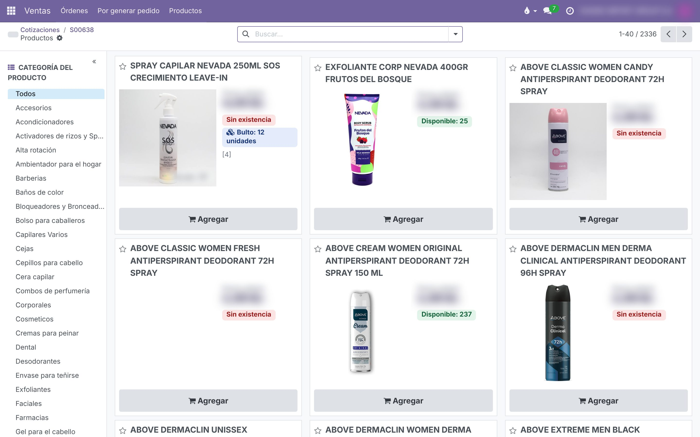
</p>

## The "distributor style"

- **Photo first, everywhere.** Order lines, delivery lines, the sales catalog, the product list and the PDF documents
  show the product photo, because warehouse staff and customers recognise products by their packaging.
- **Quantities the way the business sells.** Units per bulk pack ("Bulk: 24 units"), packs of 5/6/12 and a minimum
  quantity, enforced on the server, with the nearest valid quantity suggested (22 → 20, 23 → 25).
- **Built for phones and tablets.** Lists, delivery lines and the catalog are laid out so they fit on a phone without
  scrolling sideways; the warehouse marks lines as "Ready" with one tap.
- **The team's own vocabulary.** Invoices are shown as **"Pedidos"** (orders) on screen, because the team associates
  "factura" with tax documents. Internally they are still standard `account.move` records.
- **Measured, not guessed.** Slow screens and PDFs were timed against the real system before and after each fix
  (see [performance case studies](docs/performance-case-studies.md)).

## How the team uses it

```
Sales rep ──► Quotation / catalog ──► Confirm (payment method required) ──► Delivery order
                                                                              │
Warehouse ◄──────── picks with photos, taps "Ready" per line ◄────────────────┘
    │
Office ──► "Pedido" (invoice) ──► In warehouse ──► On route (route sheet PDF + email) ──► Delivered ──► Delivered & paid
Online customers ──► website shop / quick order / live cart ──► quotation in Sales
```

## What it adds, area by area

### 1. Sales
<p align="center">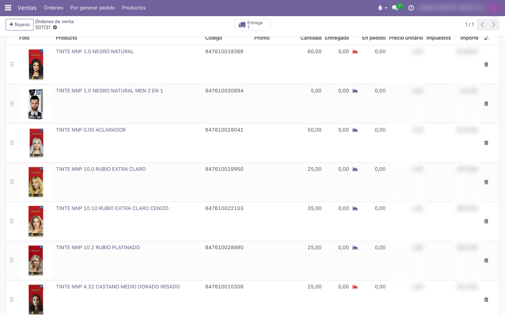</p>

- **Product catalog redesign**: 200 px photo, clear stock label ("Available: N" / "N left" / "Out of stock") computed
  only from the distributor's own warehouses, units per bulk pack, and the supplier's weekly stock as a separate
  badge. [`product_catalog_views.xml`](module/views/product_catalog_views.xml) ·
  [`catalog_promo.css`](module/static/src/css/catalog_promo.css)
- **Live promotion legend** in each catalog card ("buy X get Y"): the same text as the order line's Promo column,
  refreshed after every quantity change. [`catalog_promo.js`](module/static/src/js/catalog_promo.js) ·
  [`sale_order_catalog.py`](module/models/sale_order_catalog.py) ·
  [`controllers/catalog_promo.py`](module/controllers/catalog_promo.py)
- **Race-condition fixes** in the catalog quantity box: requests are serialised per card, and the value being typed
  is preserved when the framework re-renders the card after the server answers.
- **Payment method required to confirm**: a pop-up prefilled with the customer's last choice, plus an optional
  special delivery date. [`sale_confirm_payment_wizard.py`](module/models/sale_confirm_payment_wizard.py)
- Reward (free) lines forced to price 0, and a per-route Excel export with email for the logistics partner
  (not included here: it contains client data).

### 2. Inventory and deliveries
<p align="center">
  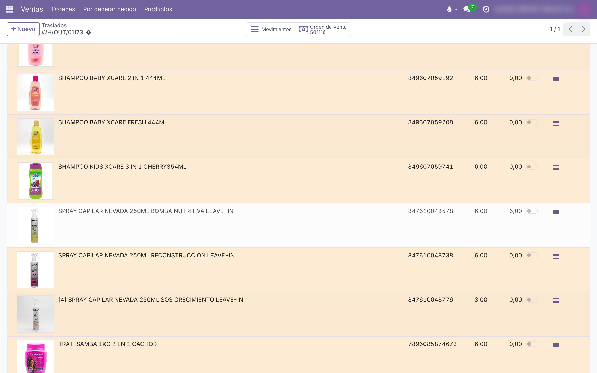
  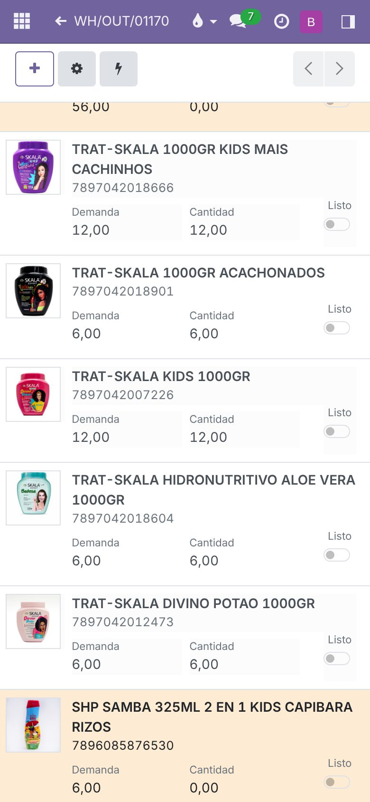
</p>

- **Delivery lines with photo and a "Ready" toggle**; on phones each line becomes a card (photo · name · code ·
  demand / quantity / ready). Lines can't be deleted by accident.
- **Orange rows** when the quantity is below the demand but the supplier reports stock: "it may be on its way".
- **Promotion notices while picking**: the gift line says how many paid units are ready and whether the gift
  quantity is right.
- **Lightweight onchange**: editing one line of a 134-line delivery used to recompute the whole record (~2.5 s per
  edit); simple line edits now return immediately. [`stock_picking.py`](module/models/stock_picking.py)
- **No screen jump** when ticking lines after editing one; the top bar hides on scroll to give the lines more room.
  [`list_no_jump.js`](module/static/src/js/list_no_jump.js) · [`dk_cp_hide.js`](module/static/src/js/dk_cp_hide.js)

<p align="center">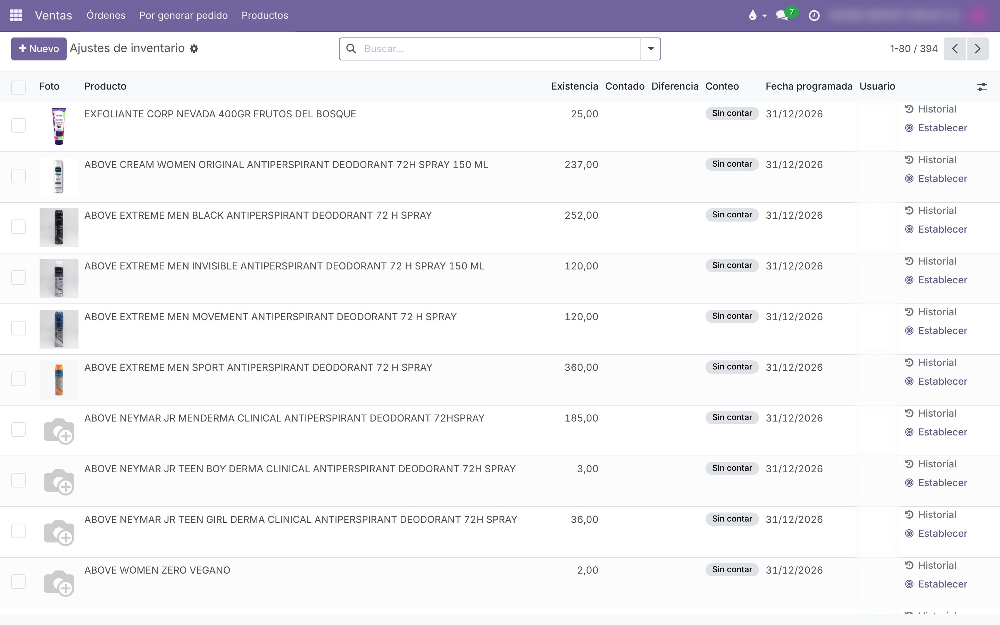</p>

- **Physical inventory with photos** and a status per line (Not counted / Counted / Difference). Safety rule: **whoever
  counts can't apply**; only inventory managers apply the adjustment.
  [`stock_quant_conteo.py`](module/models/stock_quant_conteo.py) ·
  [`stock_quant_conteo_views.xml`](module/views/stock_quant_conteo_views.xml)
- **"Running low"** built on Odoo's native replenishment (min/max rules), with extra columns and phone cards.
  [`stock_orderpoint_porgotar.py`](module/models/stock_orderpoint_porgotar.py) ·
  [`dk_por_agotar_views.xml`](module/views/dk_por_agotar_views.xml)

### 3. "Pedidos" (invoices): delivery status and route sheets
<p align="center">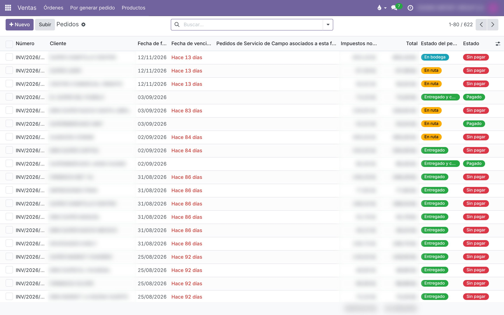</p>

- Two axes per order: **where it is** (In warehouse → On route → Delivered) and **payment** (from Odoo's payment
  state); delivered + paid = "Delivered & paid". Buttons per order and batch actions from the list.
  [`account_move_pedido_state.py`](module/models/account_move_pedido_state.py) ·
  [`account_move_pedido_views.xml`](module/views/account_move_pedido_views.xml)

<p align="center">
  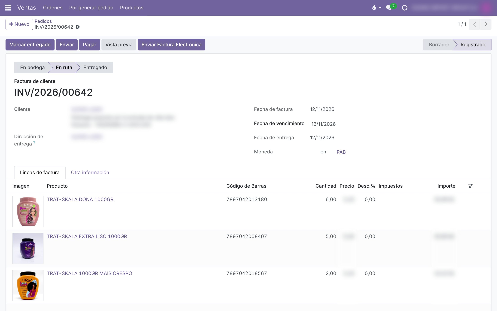
  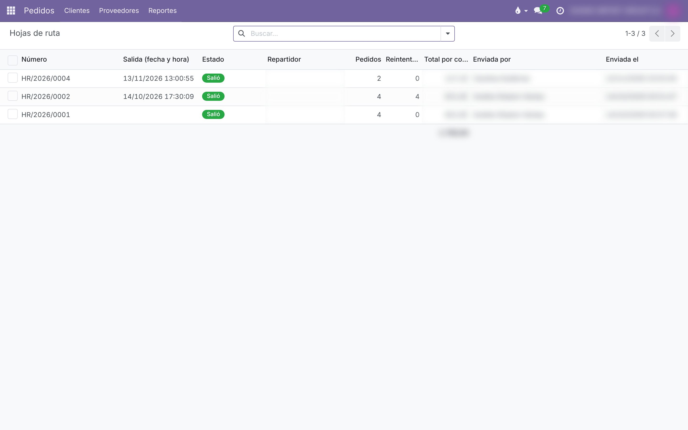
</p>

- **Route sheet**: select orders, generate a PDF with photos ordered by route position, email it to the warehouse;
  sending it moves the orders to "On route" (retries are flagged and keep their status).
  [`dk_route_sheet.py`](module/models/dk_route_sheet.py) · [`dk_route_sheet_views.xml`](module/views/dk_route_sheet_views.xml)

### 4. PDF documents with photos
<p align="center">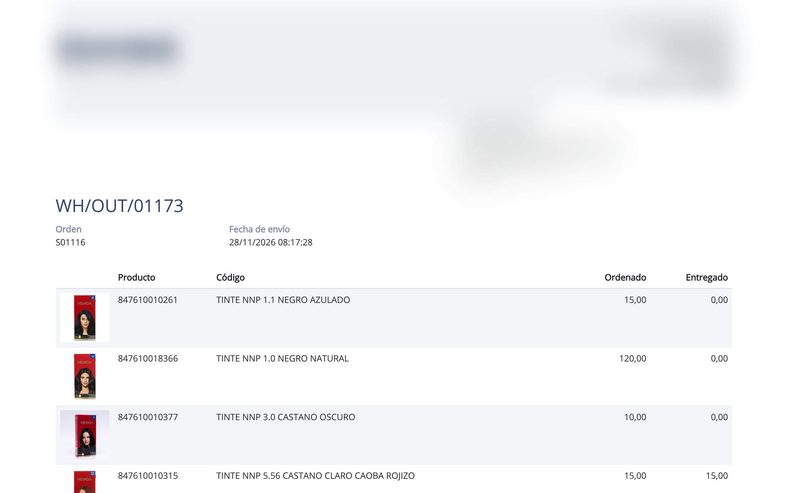</p>

Delivery slip, invoice and sale order PDFs show the product photo on every line. Embedding the 256 px thumbnail
instead of the 1024 px image cut a 6 MB / 25 s PDF to 1.6 MB / 10 s; WebP photos (which the PDF engine can't draw)
were converted to JPEG. [`product_report_image.py`](module/models/product_report_image.py) ·
[`report_deliveryslip_inherit.xml`](module/views/report_deliveryslip_inherit.xml)

### 5. Online store (B2B website)
<p align="center">
  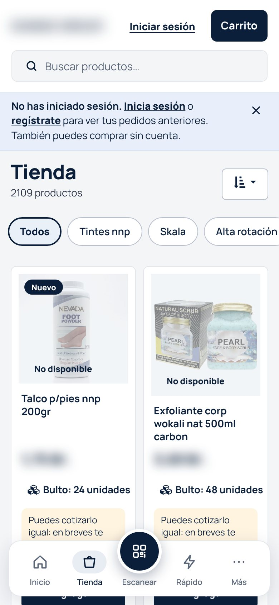
  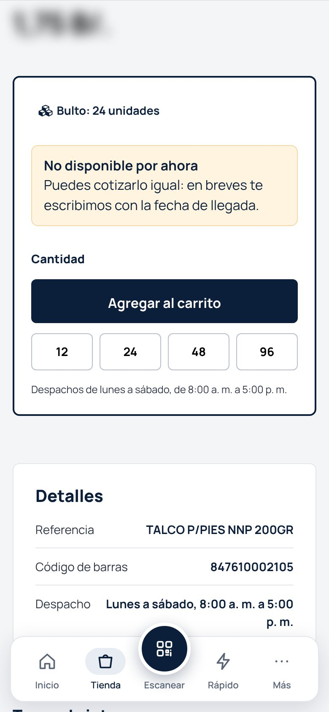
  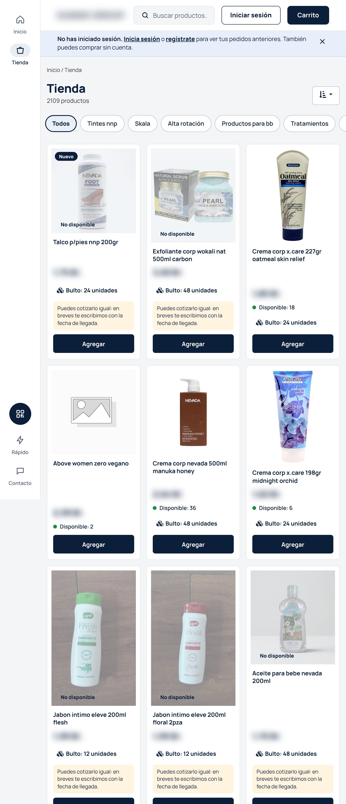
</p>

- **Redesigned shop, product and cart pages** with an app-like navigation (bottom bar on phones, side rail on tablets).
- **Search that tolerates typos and abbreviations**: editable synonyms, accent-insensitive index, barcode search and
  live suggestions in the header. [`product_template_search.py`](module/models/product_template_search.py) ·
  [`shop_search_synonym.py`](module/models/shop_search_synonym.py) · [`header_search.js`](module/static/src/js/header_search.js)
- **Live cart**: typing a quantity updates the cart immediately; the quantity rules are applied on the server.
  [`shop_live_cart.py`](module/controllers/shop_live_cart.py) · [`shop_live_cart.js`](module/static/src/js/shop_live_cart.js) ·
  [`dkh_rules.py`](module/models/dkh_rules.py)
- **Availability shown honestly**: "Available: N" from the distributor's warehouses only; out-of-stock products can
  still be quoted ("we'll write with the arrival date"). [`product_web_stock.py`](module/models/product_web_stock.py)

<p align="center">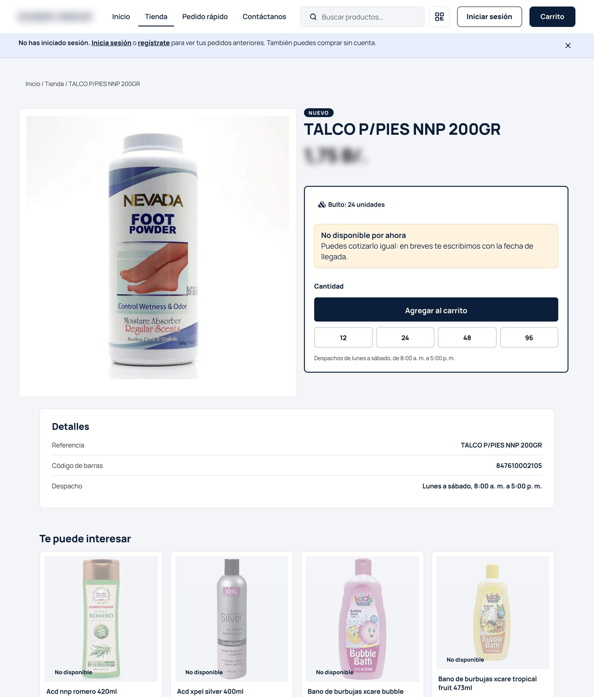</p>

### 6. Camera, zoom and mobile lists
- **Camera in the chatter of every document**: full-screen capture of photos (full sensor resolution) and video,
  burst mode, and an IndexedDB upload queue that survives closing the page and retries automatically.
  [`dk_camera.js`](module/static/src/js/dk_camera.js)
- **Gallery-style zoom** (pinch, double tap, drag, wheel) in the camera review and the attachment viewer.
  [`dk_zoom.js`](module/static/src/js/dk_zoom.js) · [`dk_viewer_zoom.js`](module/static/src/js/dk_viewer_zoom.js)
- **Responsive lists** for phones and tablets. [`responsive_lists.css`](module/static/src/css/responsive_lists.css)

<p align="center">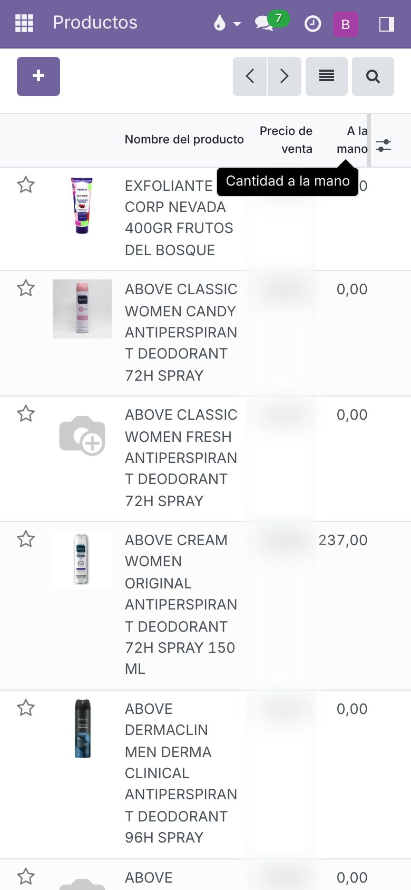</p>

## Technical notes

- **Odoo 18** module. Depends on `stock`, `sale_stock`, `account`, `sale`, `sale_loyalty`, `product`, `purchase`,
  `mail`, `website_sale` and `auth_signup`.
- Python (ORM, computed fields, `onchange`, wizards, controllers), Owl/JavaScript patches of core components, QWeb
  views and reports, CSS for mobile layouts.
- Production: self-hosted on Google Cloud with Docker Swarm; one-command deploy (pull, permissions, module update, restart).
- [`tools/odoo_rpc.py`](tools/odoo_rpc.py): JSON-RPC client used to inspect data and views; writes are a dry run
  unless `--apply`, and there is no delete.
- [`docs/performance-case-studies.md`](docs/performance-case-studies.md): measured performance fixes.

© 2026 Andrés Gutiérrez · [github.com/andresabg09](https://github.com/andresabg09)

---

<a id="español"></a>

# Español

## Odoo 18 al estilo distribuidora

Un **módulo para Odoo 18** que adapta el Odoo estándar (Ventas, Inventario, Facturación, Compras y la tienda web) a
cómo trabaja de verdad una **distribuidora mayorista de productos de belleza** en Panamá: vendedores que venden por
caja, una bodega que arma pedidos grandes guiándose por fotos, una oficina que sigue cada pedido hasta que se entrega y
se cobra, y clientes que piden en línea desde el celular.

Funciona en producción sobre un Odoo 18 autoalojado (Docker Swarm en Google Cloud). Las capturas son de ese sistema
real; **los nombres de clientes, montos, precios, nombres de empleados y el logo de la clienta están difuminados**. Las
fotos y nombres de productos son el catálogo público.

> Este repositorio público muestra una **selección** del código del módulo (ver [`module/`](module)). El módulo
> completo es privado porque contiene datos de la clienta.

## El "estilo distribuidora"

- **La foto primero, en todos lados**: líneas de la orden y de la entrega, catálogo de ventas, lista de productos y los
  PDF, porque la bodega y los clientes reconocen los productos por su empaque.
- **Cantidades como se vende**: unidades por bulto ("Bulto: 24 unidades"), paquetes de 5, 6 o 12 y una cantidad mínima,
  validados en el servidor, con la cantidad válida más cercana (22 → 20, 23 → 25).
- **Hecho para celular y tablet**: listas, líneas de entrega y catálogo caben sin deslizar de lado; la bodega marca
  "Listo" con un toque.
- **El vocabulario del equipo**: en pantalla las facturas se llaman **"Pedidos"**, porque el equipo asocia "factura"
  con lo fiscal. Por dentro siguen siendo `account.move`.
- **Medido, no supuesto**: las pantallas y PDF lentos se midieron contra el sistema real antes y después de cada
  arreglo ([casos de rendimiento](docs/performance-case-studies.md)).

## Cómo lo usa el equipo

1. **Vendedor**: arma la cotización desde el catálogo (foto, existencia, bulto, promoción en vivo) y la confirma; la
   forma de pago es obligatoria.
2. **Bodega**: prepara la entrega con fotos y marca "Listo" por línea; ve en naranja lo que puede estar por llegar y el
   aviso de las promociones.
3. **Oficina**: genera el pedido, arma la hoja de ruta (PDF + correo) y sigue cada pedido: En bodega → En ruta →
   Entregado → Entregado y cobrado.
4. **Clientes en línea**: compran en la tienda web, con buscador tolerante, Pedido rápido y carrito en vivo.

## Qué agrega, por área

| Área | Lo principal |
|---|---|
| **Ventas** | Catálogo rediseñado (foto de 200 px, existencia propia, bulto, existencia del proveedor aparte), leyenda de promoción en vivo, arreglos de condiciones de carrera al escribir cantidades, forma de pago obligatoria al confirmar, regalos siempre a $0, exportación a Excel por ruta. |
| **Inventario** | Entregas con foto y "Listo" por línea (tarjetas en celular), filas naranjas, avisos de promoción al despachar, `onchange` liviano (de ~2,5 s por edición a inmediato), inventario físico con foto y la regla "quien cuenta no aplica", "Por agotar" sobre el reabastecimiento nativo. |
| **Pedidos (facturas)** | Estado de entrega + estado de cobro, acciones por lote, hoja de ruta en PDF con fotos y correo. |
| **PDF** | Foto en cada línea; de 25 s y 6 MB a 10 s y 1,6 MB usando la miniatura de 256 px; fotos WebP pasadas a JPEG. |
| **Tienda web** | Rediseño de tienda, ficha y carrito; buscador tolerante a errores y abreviaturas con sinónimos; carrito en vivo con reglas de cantidad en el servidor; disponibilidad honesta y "cotízalo igual". |
| **Cámara y celular** | Cámara en el historial de todo documento (resolución completa, ráfaga, video, cola de subida que sobrevive a cerrar la página), zoom tipo galería y listas adaptables. |

Cada área enlaza arriba (en la sección en inglés) a los archivos de código de [`module/`](module).

## Notas técnicas

- Módulo para **Odoo 18**. Depende de `stock`, `sale_stock`, `account`, `sale`, `sale_loyalty`, `product`, `purchase`,
  `mail`, `website_sale` y `auth_signup`.
- Python (ORM, campos calculados, `onchange`, asistentes, controladores), parches Owl/JavaScript a componentes del
  núcleo, vistas y reportes QWeb, y CSS para celular.
- En producción: Google Cloud con Docker Swarm; despliegue de un solo comando (descarga, permisos, actualización del módulo y reinicio).
- [`tools/odoo_rpc.py`](tools/odoo_rpc.py): cliente JSON-RPC para revisar datos y vistas; escribir es un simulacro salvo
  `--apply`, y no existe borrar.

© 2026 Andrés Gutiérrez · [github.com/andresabg09](https://github.com/andresabg09)
